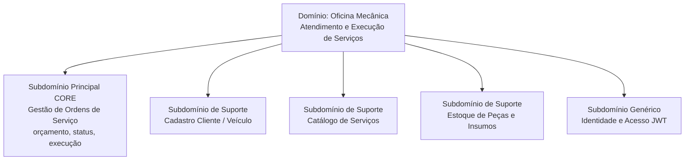
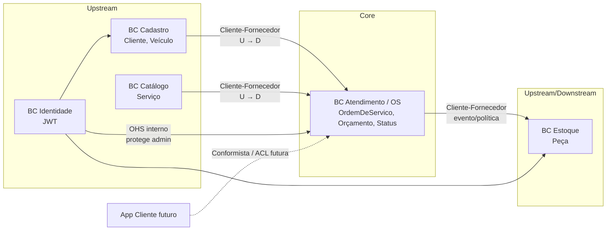
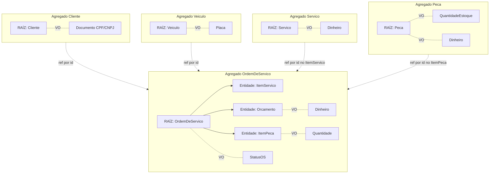
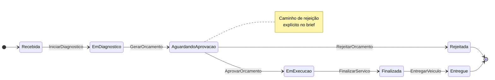
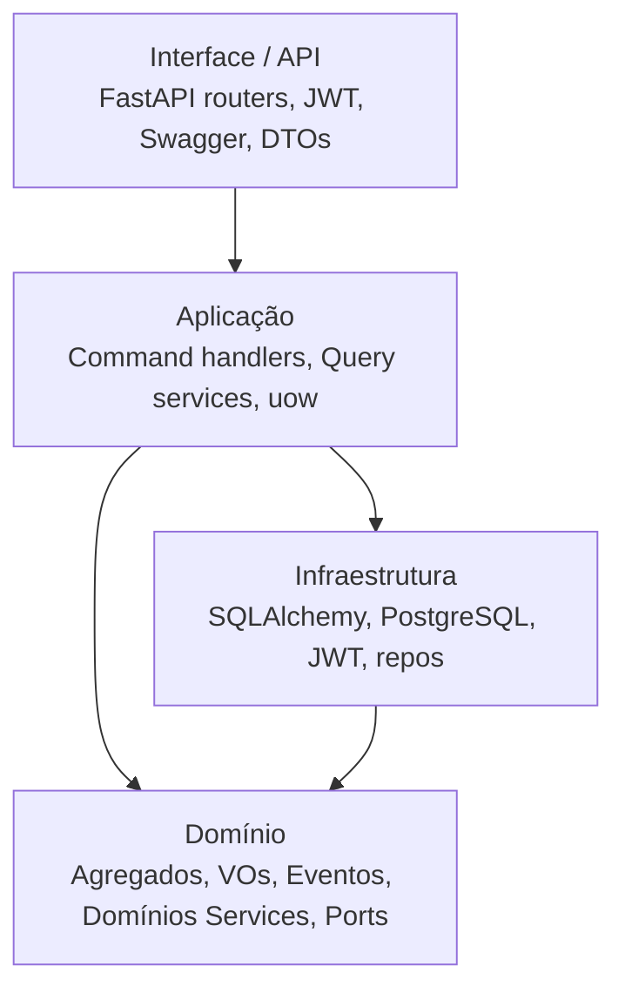

# Diagramas DDD — Oficina Mecânica (MVP)

> Diagramas solicitados pela disciplina (Aulas 01, 04, 05 e 06) alinhados à solução a implementar.

---

## 1. Subdomínios (Design Estratégico — Aula 01)



**Por quê Core = OS?** É o que diferencia a oficina neste desafio: priorização, fluxo de orçamento/autorização e acompanhamento em tempo real — exatamente as dores do brief.

**Alternativa descartada:** tratar Estoque como Core. Estoque é importante, mas é CRUD + invariante de quantidade; não é o diferencial competitivo do MVP.

---

## 2. Contextos Delimitados e Mapa de Contexto (Aulas 03–04)

No MVP monolítico, os BCs são **módulos lógicos** no mesmo deploy (não microsserviços).



| Relação | Padrão (Aula 04) | Justificativa |
|---------|------------------|---------------|
| Cadastro → OS | Cliente-Fornecedor (Cadastro U) | OS consome identidade de Cliente/Veículo por id; não altera regras de cadastro |
| Catálogo → OS | Cliente-Fornecedor | OS copia preço/descrição no ItemServico no momento da inclusão |
| OS → Estoque | Cliente-Fornecedor / política | Evento OrcamentoAprovado dispara baixa |
| Identidade → demais | Open-Host Service interno | JWT padronizado para APIs admin |
| Kernel compartilhado | **Evitado** | Aula 04 desencoraja; módulos separam modelos |

**Alternativa descartada:** um único BC “Oficina” sem fronteiras. Funciona em código pequeno, mas a documentação DDD da FIAP pede Bounded Contexts identificados — módulos deixam a defesa clara sem over-engineering.

---

## 3. Agregados, Entidades e Objetos de Valor (Aula 05)

### 3.1 Visão dos agregados



### 3.2 Por que Orçamento está DENTRO de OrdemDeServico?

| Critério | Análise |
|----------|---------|
| Invariantes juntos? | Sim: total = soma dos itens; aprovação só se status = Aguardando aprovação; rejeição encerra a OS |
| Transação única? | Sim: gerar/aprovar orçamento muda status da OS na mesma consistência |
| Ciclo de vida | Orçamento não existe sem OS neste MVP |

**Alternativa descartada:** agregado `Orcamento` separado. Útil se houvesse versionamento complexo, múltiplos orçamentos concorrentes ou BC financeiro. Para MVP de ~2 dias, aumenta fronteiras sem ganho.

### 3.3 Por que Cliente e Veículo são agregados separados?

Brief exige CRUD independente. Veículo pode mudar de dono no futuro; placa é identidade própria. OS referencia ambos por id (não aninha entidades de outro agregado — regra de Vernon/Evans).

### 3.4 Invariantes por agregado

| Agregado | Invariantes |
|----------|-------------|
| **OrdemDeServico** | Transições de status só pelas setas permitidas; orçamento ≥ 0; aprovação/rejeição só em Aguardando aprovação; entrega só após Finalizada; itens só alteráveis antes de Em execução |
| **Cliente** | Documento válido (CPF ou CNPJ); documento único no repositório |
| **Veiculo** | Placa válida e única; ano coerente |
| **Peca** | QuantidadeEstoque ≥ 0; baixa não pode resultar negativo |
| **Servico** | Preço ≥ 0; nome obrigatório |

### 3.5 Entidade vs Objeto de Valor

| Conceito | Tipo | Motivo |
|----------|------|--------|
| OrdemDeServico, Cliente, Veiculo, Peca, Servico, ItemServico, ItemPeca, Orcamento | Entidade | Identidade + ciclo de vida / mutabilidade |
| Documento, Placa, Dinheiro, Quantidade, StatusOS | Objeto de Valor | Sem id próprio; imutáveis; igualdade por valor (Aula 05) |

---

## 4. Máquina de estados da OS (transições permitidas)



Transições **proibidas** (exemplos para defesa): Recebida → Entregue; Em execução → Aguardando aprovação; Rejeitada → Em execução.

---

## 5. Arquitetura em camadas + pacotes Python/FastAPI (Aula 05)



### Estrutura de pacotes proposta

```text
oficina/
  main.py
  api/                          # Interface de Usuário (HTTP)
    deps.py                     # JWT, session
    routers/
      auth.py
      clientes.py
      veiculos.py
      servicos.py
      pecas.py
      ordens_servico.py
    schemas/                    # DTOs Pydantic (não são domínio)
  application/                  # Camada de Aplicação
    commands/
      criar_ordem_servico.py
      aprovar_orcamento.py
      ...
    queries/
      consultar_status_os.py
      tempo_medio_execucao.py
    unit_of_work.py             # porta
  domain/                       # Coração do software
    shared/
      value_objects.py          # Dinheiro, Quantidade
    cliente/
      aggregate.py
      documento.py
      events.py
      repository.py             # porta (ABC)
    veiculo/
      ...
    servico/
      ...
    peca/
      aggregate.py              # estoque
      ...
    ordem_servico/
      aggregate.py              # OS + itens + orçamento + FSM
      status.py
      events.py
      repository.py
    services/                   # domain services se necessário
  infrastructure/
    db/
      models.py                 # ORM
      repositories.py
      session.py
    auth/
      jwt.py
    unit_of_work.py
  tests/
    unit/domain/
    integration/
```

**Mapeamento bloco DDD → módulo**

| Bloco DDD | Onde |
|-----------|------|
| Entity / Aggregate / VO / Domain Event | `domain/<bc>/` |
| Domain Service | `domain/services/` |
| Repository (porta) | `domain/<bc>/repository.py` |
| Repository (adaptador) | `infrastructure/db/repositories.py` |
| Application Service / Command | `application/commands/` |
| Read model / Query | `application/queries/` |
| Controllers | `api/routers/` |

---

## 6. Banco de dados — recomendação

**Escolha: PostgreSQL.**

| Critério | Justificativa |
|----------|---------------|
| Transações ACID | OS + baixa de estoque na aprovação precisam de atomicidade (requisito explícito do brief) |
| Modelo relacional | Agregados e relacionamentos por id encaixam bem em tabelas |
| Ecossistema Python | SQLAlchemy 2 + asyncpg maduros; fácil no docker-compose |
| MVP | Um único banco; schemas/tabelas por módulo se quiser isolar BCs logicamente |

**Alternativas descartadas:**  
- **MongoDB** — flexível, mas enfraquece invariantes transacionais multi-documento no MVP.  
- **SQLite** — ótimo para teste local, fraco para demonstrar decisão de arquitetura e concorrência de estoque.

---

## 7. Relação documentação ↔ implementação

| Artefato | Implementação |
|----------|---------------|
| Eventos laranja | Classes/dataclasses em `domain/*/events.py` |
| Comandos azuis | Handlers em `application/commands/` |
| Políticas roxas | Métodos no agregado + handlers reativos simples |
| Agregados | Classes raiz com métodos de comando |
| Linguagem ubíqua | Nomes PT no domínio = este glossário |
| Máquina de estados | `OrdemDeServico.transicionar()` / mapa de transições |
