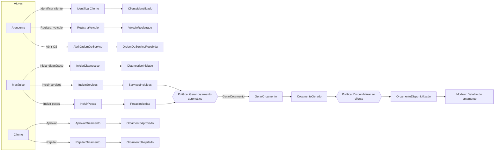
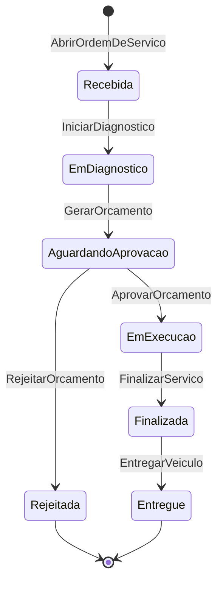
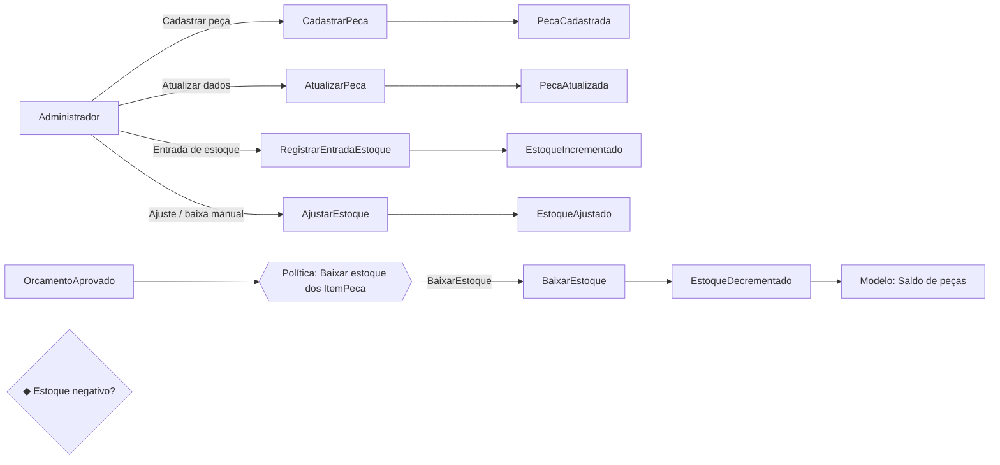
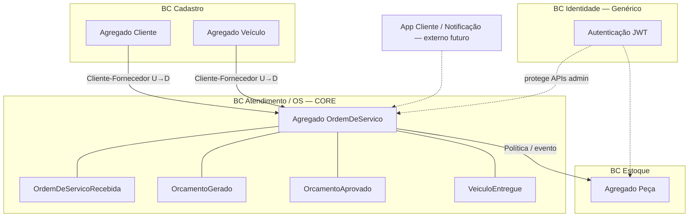

# Event Storming — Oficina Mecânica (MVP)

> Conforme Aula 06 (FIAP): eventos em laranja (verbo no passado), comandos em azul (imperativo),
> atores em amarelo, políticas em roxo, modelos de leitura em verde, sistemas externos em rosa,
> hotspots (pontos de atenção) em rosa/losango, agregados agrupando comandos/eventos.

**Domínio:** Sistema Integrado de Atendimento e Execução de Serviços de Oficina Mecânica.  
**Escopo:** MVP — três fluxos obrigatórios do brief.

Legenda de cores (convenção da disciplina):

| Elemento | Cor | Forma |
|----------|-----|-------|
| Evento de domínio | Laranja | Retângulo |
| Comando | Azul | Retângulo |
| Ator | Amarelo | Pequeno |
| Política | Roxo claro | Retângulo |
| Modelo de leitura | Verde claro | Retângulo |
| Sistema externo | Rosa | Retângulo |
| Hotspot | Rosa (losango) | Losango |
| Agregado | Amarelo escuro / borda | Agrupador |

---

## 1. Fluxo: Abertura / Criação da OS (inclui orçamento e aprovação)

### Linha do tempo (caminho feliz + rejeição)

### Elementos detalhados

| Tipo | Nome | Observação |
|------|------|------------|
| Comando | IdentificarCliente | Por CPF/CNPJ; cria ou reutiliza Cliente |
| Evento | ClienteIdentificado | |
| Comando | RegistrarVeiculo | Placa, marca, modelo, ano |
| Evento | VeiculoRegistrado | |
| Comando | AbrirOrdemDeServico | Liga Cliente + Veículo; status = Recebida |
| Evento | OrdemDeServicoRecebida | **Evento pivotal** |
| Comando | IniciarDiagnostico | Status → Em diagnóstico |
| Evento | DiagnosticoIniciado | |
| Comando | IncluirServicos / IncluirPecas | Durante diagnóstico |
| Eventos | ServicosIncluidos / PecasIncluidas | |
| Política | Quando serviços/peças estabilizados → GerarOrcamento | Automática |
| Evento | OrcamentoGerado | Status → Aguardando aprovação (**pivotal**) |
| Política | Após OrcamentoGerado → notificar/disponibilizar | |
| Evento | OrcamentoDisponibilizado | |
| Read model | DetalheOrcamento / StatusOS | Cliente consulta |
| Comando | AprovarOrcamento / RejeitarOrcamento | Ator: Cliente |
| Eventos | OrcamentoAprovado / OrcamentoRejeitado | Aprovado → Em execução; Rejeitado → fim |

### Hotspots

1. ◆ Estoque insuficiente no momento de incluir peça — reservar agora ou só na aprovação?
2. ◆ Cliente inexistente: criar na hora ou exigir cadastro prévio?
3. ◆ Orçamento pode ser regenerado após alteração de itens?

**Decisão MVP:** (1) validar disponibilidade na inclusão e **baixar estoque na aprovação**; (2) identificar ou cadastrar na abertura; (3) regenerar enquanto status ∈ {Em diagnóstico, Aguardando aprovação} e resetar aprovação se já estava aguardando.

### Agregado principal deste fluxo

**OrdemDeServico** — concentra abertura, itens, orçamento e transições até aprovação/rejeição.

---

## 2. Fluxo: Acompanhamento / Status da OS

### Comandos / eventos / políticas

| Comando | Ator | Evento | Status resultante |
|---------|------|--------|-------------------|
| AbrirOrdemDeServico | Atendente | OrdemDeServicoRecebida | Recebida |
| IniciarDiagnostico | Mecânico | DiagnosticoIniciado | Em diagnóstico |
| GerarOrcamento | Política / Mecânico | OrcamentoGerado | Aguardando aprovação |
| AprovarOrcamento | Cliente | OrcamentoAprovado | Em execução |
| RejeitarOrcamento | Cliente | OrcamentoRejeitado | Rejeitada |
| FinalizarServico | Mecânico | ServicoFinalizado | Finalizada |
| EntregarVeiculo | Atendente | VeiculoEntregue | Entregue |
| ConsultarStatusOS | Cliente | (somente leitura) | — |

**Política:** `Quando OrcamentoAprovado → iniciar execução e baixar estoque das peças`  
**Política:** `Transições inválidas são rejeitadas pelo agregado` (máquina de estados acima).

**Read models:** `StatusOSView` (cliente), `ListaOSAdmin`, `TempoMedioExecucao` (admin).

**Hotspot:** ◆ Cliente consulta por qual chave? **MVP:** id da OS + documento do cliente.

---

## 3. Fluxo: Gestão de peças / insumos (estoque)

| Tipo | Nome |
|------|------|
| Comandos | CadastrarPeca, AtualizarPeca, RegistrarEntradaEstoque, AjustarEstoque, BaixarEstoque |
| Eventos | PecaCadastrada, PecaAtualizada, EstoqueIncrementado, EstoqueAjustado, EstoqueDecrementado |
| Política | OrcamentoAprovado → BaixarEstoque para cada ItemPeca |
| Agregado | **Peca** (controle de quantidade e invariante ≥ 0) |
| Hotspot | ◆ Baixa na aprovação vs. na finalização — **MVP: na aprovação** (compromete material ao autorizar) |

---

## 4. Visão consolidada Big Picture (Event Storming)

### Eventos de domínio (lista completa MVP)

1. ClienteCadastrado / ClienteIdentificado / ClienteAtualizado  
2. VeiculoRegistrado / VeiculoAtualizado  
3. ServicoCatalogoCadastrado / Atualizado  
4. PecaCadastrada / Atualizada / EstoqueIncrementado / EstoqueDecrementado / EstoqueAjustado  
5. OrdemDeServicoRecebida  
6. DiagnosticoIniciado  
7. ServicosIncluidos / PecasIncluidas  
8. OrcamentoGerado / OrcamentoDisponibilizado  
9. OrcamentoAprovado / OrcamentoRejeitado  
10. ExecucaoIniciada (implícito na aprovação)  
11. ServicoFinalizado  
12. VeiculoEntregue  

### Políticas (resumo)

| Política | Quando | Então |
|----------|--------|-------|
| Gerar orçamento | Itens incluídos / diagnóstico pronto | Comando GerarOrcamento |
| Disponibilizar orçamento | OrcamentoGerado | Expor read model ao cliente |
| Baixar estoque | OrcamentoAprovado | BaixarEstoque por ItemPeca |
| Recusar transição inválida | Qualquer comando de status | Agregado lança erro de domínio |
| Recalcular orçamento | Itens alterados antes da aprovação | Novo OrcamentoGerado |

### Atores

- Atendente, Mecânico, Administrador (JWT)  
- Cliente (consulta + aprovação; no MVP pode ser endpoint com documento + id OS)  
- Sistema (políticas)

### Relação com o código

Cada comando → Application Service / Command Handler.  
Cada evento → registrado no agregado e (opcionalmente) publicado internamente.  
Cada agregado → módulo em `domain/`.  
Read models → queries na camada de aplicação / projeções simples SQL.

Artefatos visuais: `event-storming.png` (board sticky-notes) e `event-storming.pdf`.
