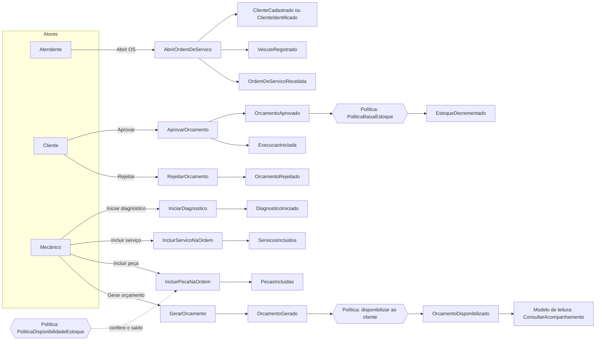
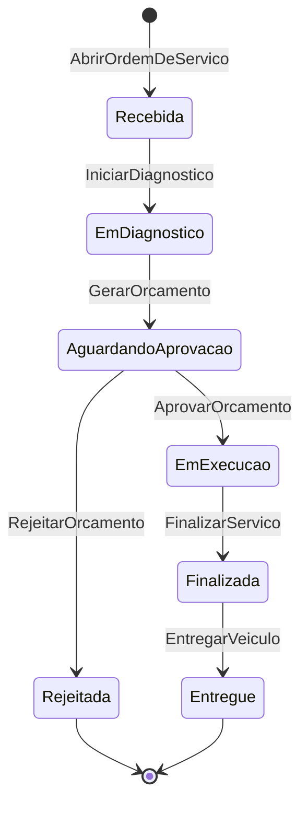
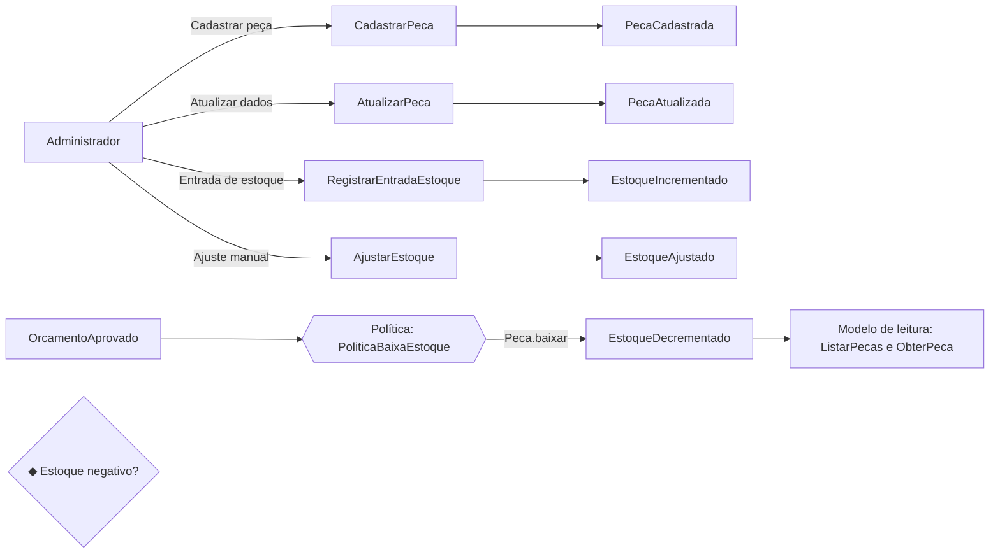
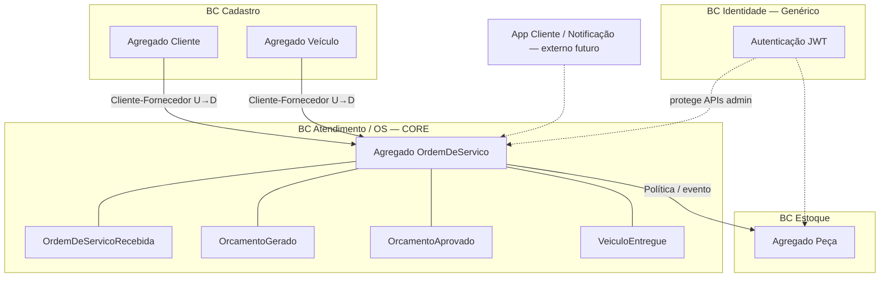

# Event Storming — Oficina Mecânica (MVP)

> Conforme Aula 06 (FIAP): eventos em laranja (verbo no passado), comandos em azul (imperativo),
> atores em amarelo, políticas em roxo, modelos de leitura em verde, sistemas externos em rosa,
> hotspots (pontos de atenção) em rosa/losango, agregados agrupando comandos/eventos.

**Domínio:** Sistema Integrado de Atendimento e Execução de Serviços de Oficina Mecânica.  
**Escopo:** MVP — três fluxos obrigatórios do brief.  
**Board:** [Miro](MIRO_BOARD_URL), com os mesmos fluxos em sticky notes. Export em `event-storming.pdf` e `event-storming.png`.

Comandos, eventos, políticas e modelos de leitura têm os nomes do código em `backend/app/`. Quando um passo acontece dentro de outro comando, a tabela indica o método que o executa.

Legenda de cores (convenção da disciplina):

| Elemento | Cor | Forma |
|----------|-----|-------|
| Evento de domínio | Laranja | Retângulo |
| Comando | Azul | Retângulo |
| Ator | Amarelo | Pequeno |
| Política | Roxo claro | Retângulo |
| Modelo de leitura | Verde claro | Retângulo |
| Sistema externo | Rosa | Retângulo |
| Hotspot | Rosa (losango) | Losango |
| Agregado | Amarelo escuro / borda | Agrupador |

---

## 1. Fluxo: Abertura / Criação da OS (inclui orçamento e aprovação)

### Linha do tempo (caminho feliz + rejeição)

### Elementos detalhados

| Tipo | Nome | Observação |
|------|------|------------|
| Comando | AbrirOrdemDeServico | Por CPF/CNPJ. Cadastra o cliente se o documento é novo (`Cliente.cadastrar`) ou o identifica (`Cliente.identificar`); registra o veículo se a placa é nova (`Veiculo.registrar`); status = Recebida |
| Eventos | ClienteCadastrado / ClienteIdentificado | Cliente novo gera os dois; cliente existente, só o segundo |
| Evento | VeiculoRegistrado | Só para placa nova |
| Evento | OrdemDeServicoRecebida | **Evento pivotal** |
| Comando | IniciarDiagnostico | Status → Em diagnóstico |
| Evento | DiagnosticoIniciado | |
| Comandos | IncluirServicoNaOrdem / IncluirPecaNaOrdem | Em diagnóstico ou Aguardando aprovação |
| Eventos | ServicosIncluidos / PecasIncluidas | |
| Comandos | RemoverServicoDaOrdem / RemoverPecaDaOrdem | Corrigem o orçamento antes da aprovação |
| Eventos | ItemServicoRemovido / ItemPecaRemovido | |
| Política | PoliticaDisponibilidadeEstoque | Na inclusão da peça, confere o saldo sem reservar |
| Comando | GerarOrcamento | Disparado pelo mecânico; exige ao menos um serviço |
| Política | Orçamento = soma das linhas | O agregado calcula o total (`OrdemDeServico._montar_orcamento`); ninguém digita valor |
| Evento | OrcamentoGerado | Status → Aguardando aprovação (**pivotal**) |
| Política | Disponibilizar ao cliente | `OrdemDeServico._publicar_orcamento` registra o evento abaixo |
| Evento | OrcamentoDisponibilizado | |
| Modelo de leitura | ConsultarAcompanhamento | Cliente consulta com o id da OS e o documento |
| Comandos | AprovarOrcamento / RejeitarOrcamento | Ator: Cliente |
| Eventos | OrcamentoAprovado e ExecucaoIniciada / OrcamentoRejeitado | Aprovado → Em execução; Rejeitado → Rejeitada |
| Política | PoliticaBaixaEstoque | Na aprovação, baixa o estoque de cada ItemPeca (`Peca.baixar`) na mesma transação |

### Hotspots

1. ◆ Estoque insuficiente no momento de incluir peça — reservar agora ou só na aprovação?
2. ◆ Cliente inexistente: criar na hora ou exigir cadastro prévio?
3. ◆ Orçamento pode ser regenerado após alteração de itens?

**Decisão MVP:** (1) `PoliticaDisponibilidadeEstoque` confere o saldo na inclusão e `PoliticaBaixaEstoque` **baixa o estoque na aprovação**; (2) `AbrirOrdemDeServico` cadastra o cliente se o documento é novo; (3) enquanto a OS aguarda aprovação, incluir ou remover item recalcula o orçamento (`OrdemDeServico._recalcular_se_aguardando`), e `GerarOrcamento` pode ser chamado de novo nesse status.

### Agregado principal deste fluxo

**OrdemDeServico** — concentra abertura, itens, orçamento e transições até aprovação/rejeição. `AbrirOrdemDeServico` também altera **Cliente** e **Veiculo**, e `AprovarOrcamento` altera **Peca**, na mesma transação.

---

## 2. Fluxo: Acompanhamento / Status da OS

### Comandos / eventos / políticas

| Comando | Ator | Evento | Status resultante |
|---------|------|--------|-------------------|
| AbrirOrdemDeServico | Atendente | OrdemDeServicoRecebida | Recebida |
| IniciarDiagnostico | Mecânico | DiagnosticoIniciado | Em diagnóstico |
| GerarOrcamento | Mecânico | OrcamentoGerado, OrcamentoDisponibilizado | Aguardando aprovação |
| AprovarOrcamento | Cliente | OrcamentoAprovado, ExecucaoIniciada | Em execução |
| RejeitarOrcamento | Cliente | OrcamentoRejeitado | Rejeitada |
| FinalizarServico | Mecânico | ServicoFinalizado | Finalizada |
| EntregarVeiculo | Atendente | VeiculoEntregue | Entregue |
| ConsultarAcompanhamento | Cliente | (somente leitura) | — |

**Política:** `Quando OrcamentoAprovado → ExecucaoIniciada e PoliticaBaixaEstoque baixa as peças, na mesma transação`  
**Política:** `Transições inválidas são rejeitadas pelo agregado` (`TRANSICOES` e `OrdemDeServico._transicionar`).

**Modelos de leitura:** `ConsultarAcompanhamento` (cliente), `ListarOrdensDeServico` e `ObterOrdemDeServico` (admin), `CalcularTempoMedioExecucao` (admin).

**Hotspot:** ◆ Cliente consulta por qual chave? **MVP:** id da OS + documento do cliente.

---

## 3. Fluxo: Gestão de peças / insumos (estoque)

| Tipo | Nome |
|------|------|
| Comandos | CadastrarPeca, AtualizarPeca, RegistrarEntradaEstoque, AjustarEstoque |
| Eventos | PecaCadastrada, PecaAtualizada, EstoqueIncrementado, EstoqueAjustado, EstoqueDecrementado |
| Política | PoliticaBaixaEstoque: OrcamentoAprovado → `Peca.baixar` para cada ItemPeca |
| Agregado | **Peca** (`quantidade_estoque` ≥ 0) |
| Hotspot | ◆ Estoque negativo — **MVP:** `Peca.baixar` recusa a baixa e o banco tem `CHECK quantidade_estoque >= 0` |
| Hotspot | ◆ Baixa na aprovação vs. na finalização — **MVP: na aprovação** (compromete material ao autorizar) |

---

## 4. Visão consolidada Big Picture (Event Storming)

### Eventos de domínio (lista completa MVP)

1. ClienteCadastrado / ClienteIdentificado / ClienteAtualizado  
2. VeiculoRegistrado / VeiculoAtualizado  
3. ServicoCatalogoCadastrado / ServicoCatalogoAtualizado  
4. PecaCadastrada / PecaAtualizada / EstoqueIncrementado / EstoqueDecrementado / EstoqueAjustado  
5. OrdemDeServicoRecebida  
6. DiagnosticoIniciado  
7. ServicosIncluidos / PecasIncluidas / ItemServicoRemovido / ItemPecaRemovido  
8. OrcamentoGerado / OrcamentoDisponibilizado  
9. OrcamentoAprovado / OrcamentoRejeitado  
10. ExecucaoIniciada (registrado junto com OrcamentoAprovado)  
11. ServicoFinalizado  
12. VeiculoEntregue  

### Políticas (resumo)

| Política | Quando | Então |
|----------|--------|-------|
| Orçamento = soma das linhas | Mecânico dispara GerarOrcamento | O agregado calcula o total e exige ao menos um serviço |
| Disponibilizar orçamento | OrcamentoGerado | OrcamentoDisponibilizado e consulta na rota pública |
| Validar disponibilidade | IncluirPecaNaOrdem | PoliticaDisponibilidadeEstoque confere o saldo, sem reservar |
| Baixar estoque | OrcamentoAprovado | PoliticaBaixaEstoque chama `Peca.baixar` por ItemPeca |
| Recusar transição inválida | Qualquer comando de status | Agregado lança erro de domínio |
| Recalcular orçamento | Itens alterados em Aguardando aprovação | Novo OrcamentoGerado e OrcamentoDisponibilizado |

### Atores

- Atendente, Mecânico, Administrador (JWT)  
- Cliente (consulta e decide o orçamento pela rota pública, com o id da OS e o documento, sem JWT)  
- Sistema (políticas)

### Relação com o código

Os caminhos abaixo são relativos a `backend/app/`.

Cada comando → handler em `application/commands/`.  
Cada evento → dataclass em `domain/*/events.py`, registrada no agregado e gravada na tabela `eventos_dominio` na mesma transação do comando.  
Cada agregado → módulo em `domain/`.  
Modelos de leitura → consultas em `application/queries/`.  
Políticas → `domain/services/politica_estoque.py` e métodos de `OrdemDeServico`.

O mapeamento completo está em [`mapeamento-codigo.md`](mapeamento-codigo.md).
